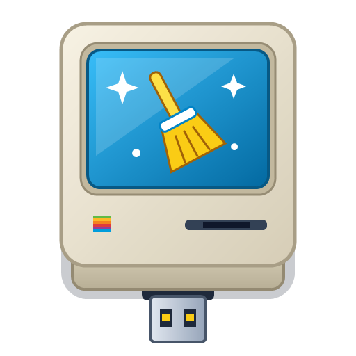

# CleanMacUSB

**Utilidad nativa para Windows que elimina todos los archivos ocultos y residuales generados por macOS, Windows, Linux y Smart TVs en memorias USB, discos duros y carpetas.**

[-0284C7?style=for-the-badge&logo=windows)](https://microsoft.com)

*Disponible en **Español (ES)**, **Inglés (EN)**, **Alemán (DE)**, **Francés (FR)** y **Chino (ZH)**.*

---

## 🎯 ¿Para qué sirve CleanMacUSB?

Cuando conectas un pendrive o disco externo en un ordenador **Mac**, **Windows**, **Linux** o en un televisor **Smart TV**, el sistema crea de forma invisible decenas de carpetas y archivos ocultos de indexación, papeleras y metadatos.

Estos archivos residuales provocan problemas frecuentes:
- 📺 **En televisores y reproductores multimedia:** Aparecen archivos duplicados fantasma (como `._Pelicula.mp4`) que dan error al intentar reproducirlos.
- 🚗 **En radios y equipos de sonido de coches:** Bloquean la lectura de carpetas MP3 al intentar reproducir archivos ocultos (`._*` o `Thumbs.db`).
- 🎧 **En equipos DJ (Pioneer CDJ / XDJ), marcos digitales e impresoras 3D:** Ensucian los listados de archivos y ralentizan la carga.
- 💾 **Falta de espacio real en el USB:** Las papeleras ocultas (`.Trashes`, `$RECYCLE.BIN`, `.Trash-1000`) siguen ocupando gigabytes aunque hayas borrado los archivos.

**CleanMacUSB** limpia de raíz todos estos elementos en segundos y permite expulsar el dispositivo USB de forma totalmente segura.

---

## 🧹 ¿Qué archivos y carpetas elimina?

Puedes elegir todas las categorías a la vez con el botón **«☑ Elegir todo»** o seleccionar únicamente las que necesites:

| Sistema | Categoría | Archivos y carpetas que elimina |
| :--- | :--- | :--- |
| 🍎 **macOS** | **Archivos AppleDouble y ZIPs** | `._*` (archivos fantasma duplicados), `__MACOSX`, `.MACOSX`, `.AppleDouble`, `.AppleDB`, `.AppleDesktop` |
| 🍎 **macOS** | **Configuración de carpetas e iconos** | `.DS_Store`, `.VolumeIcon.icns`, `.apdisk`, `.com.apple.timemachine.donotpresent`, `.metadata_never_index` |
| 🍎 **macOS** | **Spotlight, QuickLook y Papeleras** | `.Spotlight-V100`, `.Spotlight-V200`, `.Trashes`, `.fseventsd`, `.TemporaryItems`, `.ql_tcache`, `.QuickLook`, `.hotfiles.btree`, `.DocumentRevisions-V100` |
| 🪟 **Windows** | **Cachés de miniaturas y vistas** | `Thumbs.db`, `ehthumbs.db`, `ehthumbs_vista.db`, `desktop.ini`, `ZbThumbnail.info`, `WPSettings.dat`, `IndexerVolumeGuid` y `System Volume Information` vacía |
| 🪟 **Windows** | **Papelera y fragmentos CHKDSK** | `$RECYCLE.BIN`, `RECYCLER`, `RECYCLED`, carpetas `FOUND.000` / `FOUND.*` y fragmentos `*.chk` |
| 🪟 **Windows** | **Residuales `README.`, bloqueos y temporales** | `README.`, `README`, `README.txt`, bloqueos ocultos de Office (`~$*`, `~WRL*.tmp`), `msdownld.tmp` y temporales (`*.tmp`, `*.bak`) |
| 🐧 **Linux** | **Papeleras, vistas y archivos temporales** | `.Trash`, `.Trash-1000`, `.Trash-*`, `.directory`, `.hidden`, `.fuse_hidden*`, `.nfs*`, `.goutputstream-*`, `.*.swp`, `.*.swo` |
| 📺 **Smart TV / Android** | **Televisores Smart TV y Móviles Android** | `LOST.DIR`, `LG Smart TV`, `.lg_tv`, `.android_secure`, `.Samsung`, `.DEV_INFO`, `.thumbnails`, `.thumbdata*`, `.database_uuid`, `albumart.pamp`, `.estrongs`, `.DataStorage`, `mstpvr`, y carpetas esqueleto vacías (`Android`, `Alarms`, `Ringtones`, `Podcasts`...) |

---

## ✨ Características Principales

- 💾 **Selector Agrupado en 3 Apartados (USB, Discos Internos y Carpetas):**
  - El desplegable inicia **vacío por defecto** (con el botón de limpiar deshabilitado hasta elegir un destino) para evitar limpiezas accidentales.
  - Separa claramente las unidades en 3 apartados: **🔌 Memorias Externas (USB)**, **💻 Memorias Internas (Discos del PC)** y **📁 Carpetas** (Escritorio, Descargas, Documentos o cualquier carpeta elegida con **«📁 Elegir carpeta...»**).
  - Muestra un aviso de precaución al seleccionar un disco duro interno y protege las carpetas críticas de Windows.
- 🛡 **Confirmación y Resumen Final:** Solicita confirmación antes de comenzar la limpieza y, al finalizar, muestra una ventana de resumen con el total de archivos eliminados y espacio liberado.
- 📋 **Registro de Actividad en Tiempo Real:** Muestra el progreso, cada archivo o carpeta eliminada con su tamaño, opción para **guardar el registro en `.txt`** y botón **«⏹ Abortar limpieza»** para detener el proceso en cualquier momento.
- ⏏ **Expulsión Segura de USB:** Desmonta y expulsa físicamente el pendrive para poder retirarlo sin riesgo de corrupción de datos (con opción de expulsión automática al terminar).
- ⚙ **Apartado de Ajustes:**
  - Selector de idioma en tiempo real (**Español**, **Inglés**, **Alemán**, **Francés** y **Chino**) sin necesidad de reiniciar.
  - **Actualizaciones automáticas** (se oculta automáticamente si la app se ejecuta desde Microsoft Store).
  - Opción para **ejecutar en segundo plano (Bandeja del sistema)** y recibir un aviso automático cada vez que conectes un USB nuevo.
  - Información de versión, visor de licencia EULA y enlace directo de apoyo al creador.

---

## 📥 Instalación

Ejecuta el instalador **`CleanMacUSB_Setup_v1.0.exe`** y sigue los pasos en pantalla. No requiere instalar nada adicional.

---

## 📜 Licencia, Privacidad y Autoría

- **Producto:** CleanMacUSB v1.0
- **Desarrollador y Autor:** **Josan Sánchez**
- **Privacidad:** 100 % local, sin recopilación ni envío de datos ([`PRIVACY.md`](PRIVACY.md)).
- **Licencia:** Software Gratuito y Propietario (*Freeware*).
  - Uso gratuito permitido a nivel personal y profesional.
  - Prohibida su venta, modificación o redistribución comercial sin permiso del autor. Textos legales completos en [`assets/EULA_ES.txt`](assets/EULA_ES.txt) y [`assets/EULA_EN.txt`](assets/EULA_EN.txt).

---

  Desarrollado por <strong>Josan Sánchez</strong> — Copyright © 2026 Todos los derechos reservados.

